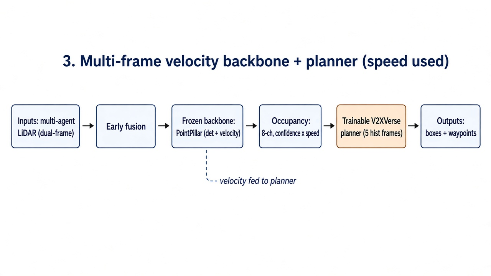

# Planning Results: Frozen Backbone + V2XVerse Planner

**Dataset:** OPV2V. Backbones and planners are trained on the **train** split. Detection AP and planning ADE / FDE are both reported on the held-out **test** split (`n=2170`), which is never used for training.

This note compares four setups that share the same V2XVerse-style planning module. In each case the perception backbone is frozen, and only the planner is trained.

0. **Single-frame detection-only** → baseline without velocity and without dual-frame input
1. **Dual-frame detection-only** → add dual-frame temporal fusion (still no velocity head)
2. **Dual-frame with velocity (unused)** → backbone trained with velocity; speed not fed to the planner
3. **Dual-frame with velocity (used)** → backbone trained with velocity; confidence-gated speed fed to the planner

**Metric:** ADE / FDE (meters). Lower is better. Planning eval `n=2170` (held-out test).

| # | Backbone | Frames | Velocity head | AP @ 0.3 / 0.5 / 0.7 | Speed MAE / RMSE | ADE / FDE |
|---|----------|--------|---------------|----------------------|------------------|-----------|
| 0 | Detection-only | single | no | 0.93 / 0.92 / 0.86 | — | 0.7089 / 1.5281 |
| 1 | Detection-only | dual | no | 0.93 / 0.93 / 0.88 | — | 0.5919 / 1.2634 |
| 2 | Detection + velocity | dual | yes (unused by planner) | 0.92 / 0.91 / 0.85 | 0.549 / 0.878 m/s | 0.6403 / 1.3899 |
| 3 | Detection + velocity | dual | yes (used by planner) | 0.92 / 0.91 / 0.85 | 0.549 / 0.878 m/s | 0.7706 / 1.6203 |

---

## 0. Single-frame detection-only backbone + V2XVerse planner

Baseline without velocity and without dual-frame input. The backbone is a single-frame detection-only PointPillar (`dual_frame: false`, no velocity head). Its weights are frozen. The V2XVerse planning module is trained on top.

Frozen backbone itself (no planner):

| Task | Metric | Value |
|------|--------|-------|
| Detection | AP @ 0.3 / 0.5 / 0.7 | 0.93 / 0.92 / 0.86 |
| Velocity | Speed MAE / RMSE | — |

Planner (frozen backbone + V2XVerse planner):

| Metric | Value |
|--------|-------|
| ADE    | 0.7089 |
| FDE    | 1.5281 |

---

## 1. Dual-frame detection-only backbone + V2XVerse planner

Same as Experiment 0, except the frozen backbone uses dual-frame input and temporal fusion (still no velocity head). Dual-frame is kept so later dual-frame experiments share the same temporal architecture.

Frozen backbone itself (no planner):

| Task | Metric | Value |
|------|--------|-------|
| Detection | AP @ 0.3 / 0.5 / 0.7 | 0.93 / 0.93 / 0.88 |
| Velocity | Speed MAE / RMSE | — |

Planner (frozen backbone + V2XVerse planner):

| Metric | Value |
|--------|-------|
| ADE    | 0.5919 |
| FDE    | 1.2634 |

---

## 2. Dual-frame velocity backbone + V2XVerse planner

Same dual-frame architecture as Experiment 1, but the backbone was also trained with velocity estimation. Its weights are frozen. The planner still does not receive predicted speed.

Frozen backbone itself (no planner):

| Task | Metric | Value |
|------|--------|-------|
| Detection | AP @ 0.3 / 0.5 / 0.7 | 0.92 / 0.91 / 0.85 |
| Velocity | Speed MAE / RMSE | 0.549 / 0.878 m/s |

Planner (frozen backbone + V2XVerse planner):

| Metric | Value |
|--------|-------|
| ADE    | 0.6403 |
| FDE    | 1.3899 |

---

## 3. Dual-frame velocity backbone + confidence-gated speed in planner

Frozen backbone itself (no planner):

| Task | Metric | Value |
|------|--------|-------|
| Detection | AP @ 0.3 / 0.5 / 0.7 | 0.92 / 0.91 / 0.85 |
| Velocity | Speed MAE / RMSE | 0.549 / 0.878 m/s |

Planner (frozen backbone + V2XVerse planner):

| Metric | Value |
|--------|-------|
| ADE    | 0.7706 |
| FDE    | 1.6203 |

---

**Takeaway:**
- **0 → 1:** Dual-frame fusion cuts ADE 0.709 → 0.592.
- **1 → 2:** Velocity training without using speed raises ADE 0.592 → 0.640.
- **2 → 3:** Confidence-gated speed into the planner raises ADE 0.640 → 0.771.
