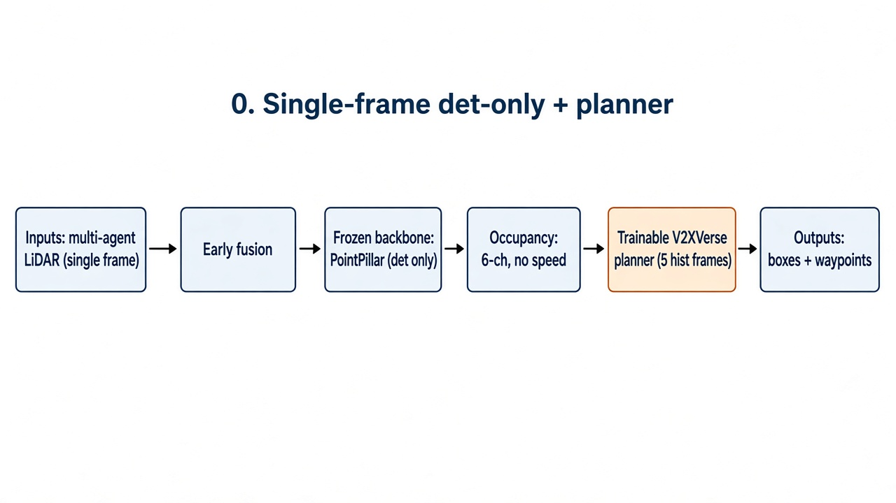
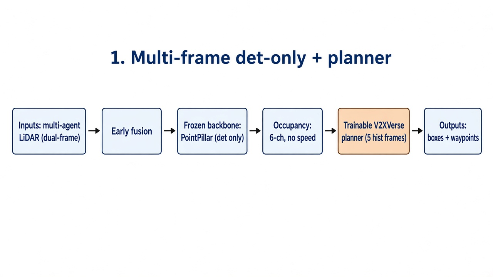
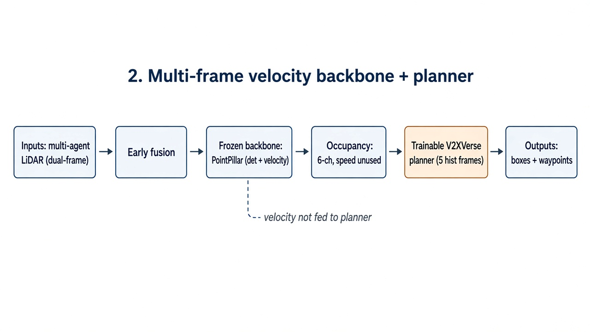

# Planning Results: Frozen Backbone + V2XVerse Planner

This note compares three setups that share the same V2XVerse-style planning module. In each case the perception backbone is frozen, and only the planner is trained. The planner uses the original 6-channel occupancy representation (no speed channel is passed into planning).

The series isolates backbone frame count and velocity training:

0. **Single-frame detection-only** → baseline without velocity and without multi-frame input
1. **Multi-frame detection-only** → add dual-frame temporal fusion (still no velocity head)
2. **Multi-frame with velocity** → same dual-frame architecture, backbone also trained with velocity estimation (speed still not fed to the planner)

**Metric:** ADE / FDE (meters). Lower is better. Planning eval `n=2170` (held-out test).

| # | Backbone | Frames | Velocity head | AP @ 0.3 / 0.5 / 0.7 | ADE / FDE |
|---|----------|--------|---------------|----------------------|-----------|
| 0 | Detection-only | single | no | 0.90 / 0.89 / 0.83 | 0.7089 / 1.5281 |
| 1 | Detection-only | dual | no | 0.90 / 0.89 / 0.85 | 0.5919 / 1.2634 |
| 2 | Detection + velocity | dual | yes (unused by planner) | 0.92 / 0.91 / 0.85 | 0.6403 / 1.3899 |

---

## 0. Single-frame detection-only backbone + V2XVerse planner

Baseline without velocity and without multi-frame input. The backbone is a single-frame detection-only PointPillar (`dual_frame: false`, no velocity head). Its weights are frozen. The V2XVerse planning module is trained on top.

Frozen backbone itself (no planner):

| Task | Metric | Value |
|------|--------|-------|
| Detection | AP @ 0.3 / 0.5 / 0.7 | 0.90 / 0.89 / 0.83 |
| Velocity | Speed MAE / RMSE | — |

Planner (frozen backbone + V2XVerse planner):

| Metric | Value |
|--------|-------|
| ADE    | 0.7089 |
| FDE    | 1.5281 |

---

## 1. Multi-frame detection-only backbone + V2XVerse planner

Same as Experiment 0, except the frozen backbone uses dual-frame input and temporal fusion (still no velocity head).

Frozen backbone itself (no planner):

| Task | Metric | Value |
|------|--------|-------|
| Detection | AP @ 0.3 / 0.5 / 0.7 | 0.90 / 0.89 / 0.85 |
| Velocity | Speed MAE / RMSE | — |

Planner (frozen backbone + V2XVerse planner):

| Metric | Value |
|--------|-------|
| ADE    | 0.5919 |
| FDE    | 1.2634 |

---

## 2. Multi-frame velocity backbone + V2XVerse planner

Same dual-frame architecture as Experiment 1, but the backbone was also trained with velocity estimation. Its weights are frozen. The planner still does not receive predicted speed.

Frozen backbone itself (no planner):

| Task | Metric | Value |
|------|--------|-------|
| Detection | AP @ 0.3 / 0.5 / 0.7 | 0.92 / 0.91 / 0.85 |
| Velocity | Speed MAE / RMSE | 0.549 / 0.878 m/s |

Planner (frozen backbone + V2XVerse planner):

| Metric | Value |
|--------|-------|
| ADE    | 0.6403 |
| FDE    | 1.3899 |

---

**Takeaway:** Dual-frame temporal fusion is the largest win for planning (Exp 0 → 1: ADE 0.709 → 0.592) at nearly matched detection AP. Adding velocity training on that dual-frame backbone without feeding speed to the planner hurts planning (Exp 1 → 2: ADE 0.592 → 0.640) even though detection AP rises slightly. Best no-motion planner here remains the multi-frame detection-only backbone.
