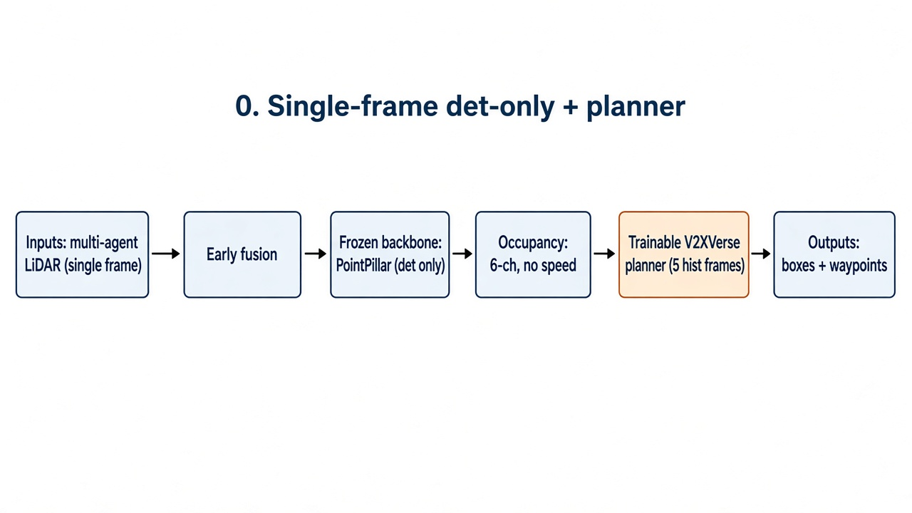
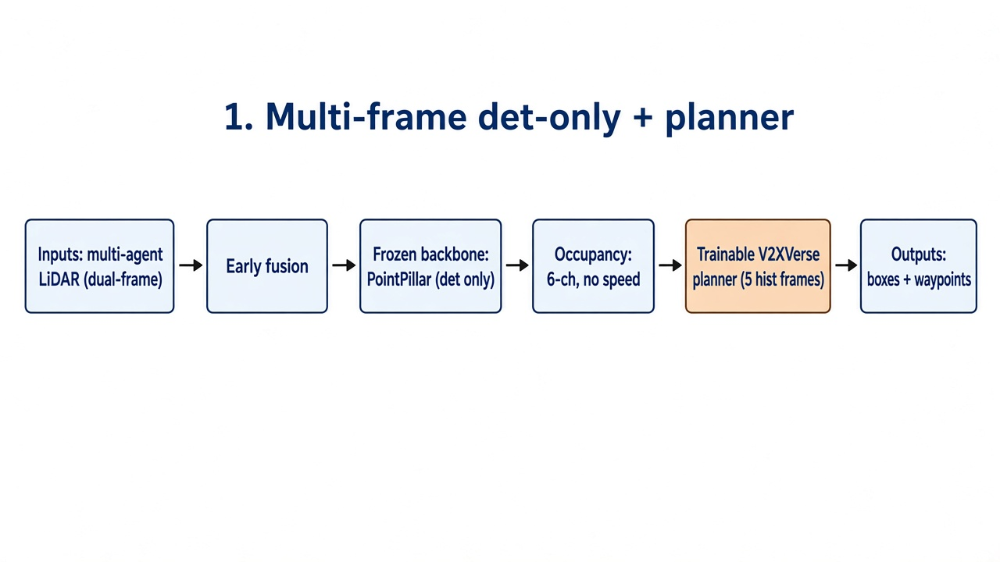
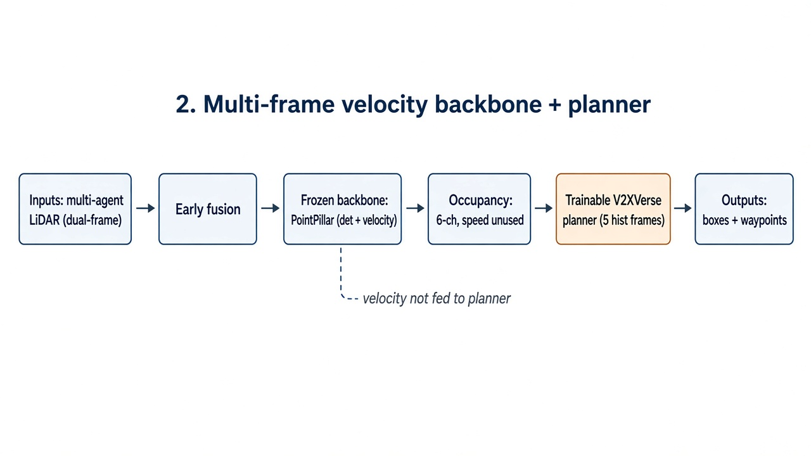

# Planning Results: Frozen Backbone + V2XVerse Planner

This note compares setups that share the same V2XVerse-style planning module. In each case the perception backbone is frozen, and only the planner is trained. The planner uses the original occupancy representation (no speed channel is passed into planning).

**Metric:** ADE / FDE (meters). Lower is better.

---

## 0. Single-frame detection-only backbone + V2XVerse planner

Baseline without velocity and without multi-frame input. The backbone is a single-frame detection-only PointPillar (no velocity head, `dual_frame: false`). Its weights are frozen. The V2XVerse planning module is trained on top.

Frozen backbone itself (no planner):

| Task | Metric | Value |
|------|--------|-------|
| Detection | AP @ 0.3 / 0.5 / 0.7 | pending (`x2_detection_single`) |
| Velocity | Speed MAE / RMSE | — |

Planner (frozen backbone + V2XVerse planner):

| Metric | Value |
|--------|-------|
| ADE    | pending (`path_v2xverse_det_only_single`) |
| FDE    | pending |

---

## 1. Multi-frame detection-only backbone + V2XVerse planner

The backbone is our detection-only model (no velocity head) with dual-frame input. Its weights are frozen. The V2XVerse planning module is trained on top.

Frozen backbone itself (no planner):

| Task | Metric | Value |
|------|--------|-------|
| Detection | AP @ 0.3 / 0.5 / 0.7 | 0.90 / 0.89 / 0.85 |
| Velocity | Speed MAE / RMSE | — |

Planner (frozen backbone + V2XVerse planner):

| Metric | Value |
|--------|-------|
| ADE    | 0.5919 |
| FDE    | 1.2634 |

---

## 2. Multi-frame velocity backbone + V2XVerse planner

The backbone is our model trained with velocity estimation (dual-frame). Its weights are frozen. The same V2XVerse planning module is trained on top, still without feeding predicted speed into the planner.

Frozen backbone itself (no planner):

| Task | Metric | Value |
|------|--------|-------|
| Detection | AP @ 0.3 / 0.5 / 0.7 | 0.92 / 0.91 / 0.85 |
| Velocity | Speed MAE / RMSE | 0.549 / 0.878 m/s |

Planner (frozen backbone + V2XVerse planner):

| Metric | Value |
|--------|-------|
| ADE    | 0.6403 |
| FDE    | 1.3899 |

---

**Takeaway:** With the same V2XVerse planner and no motion input to planning, the multi-frame detection-only frozen backbone outperforms the velocity-trained frozen backbone on ADE and FDE. Detection AP is slightly higher for the velocity-trained backbone. The single-frame detection-only baseline (section 0) is pending.
